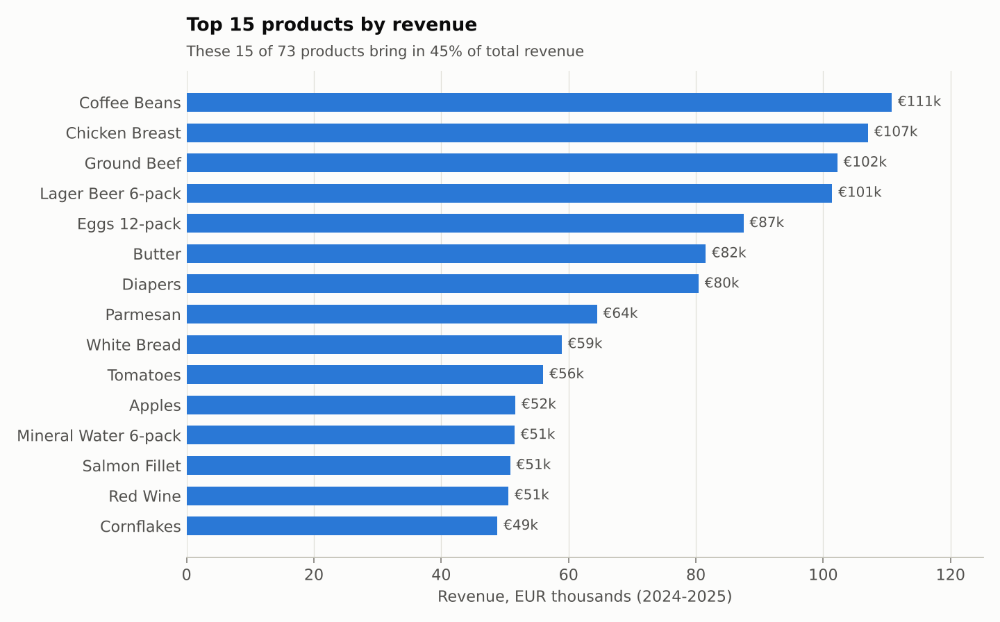
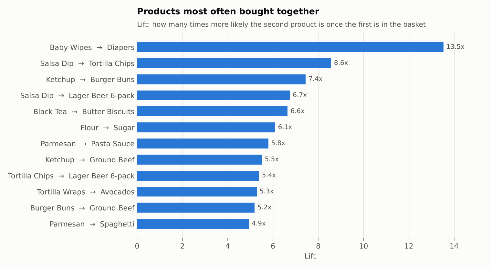
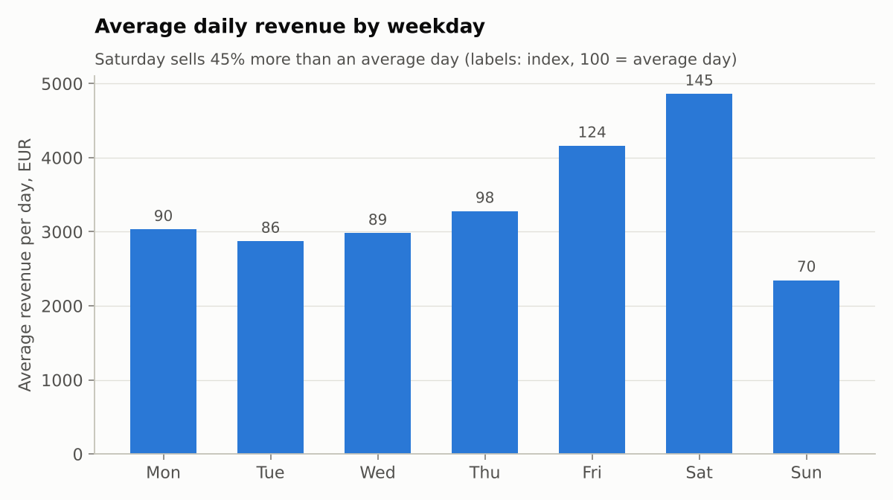
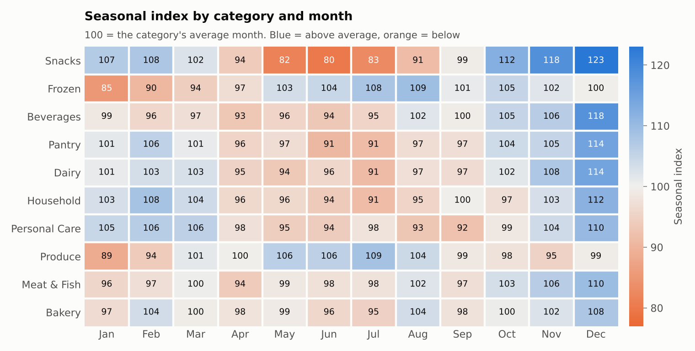
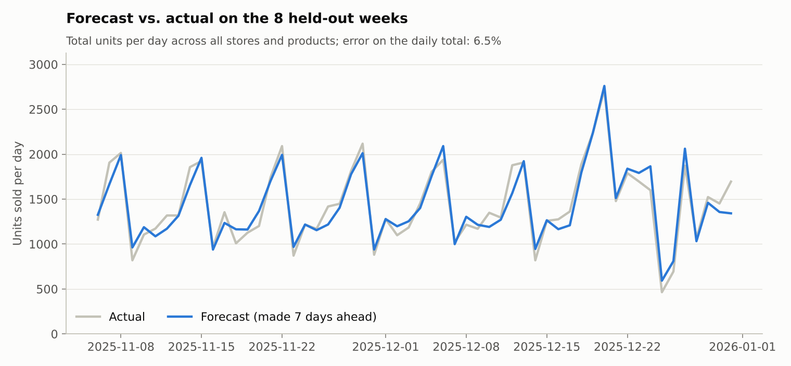
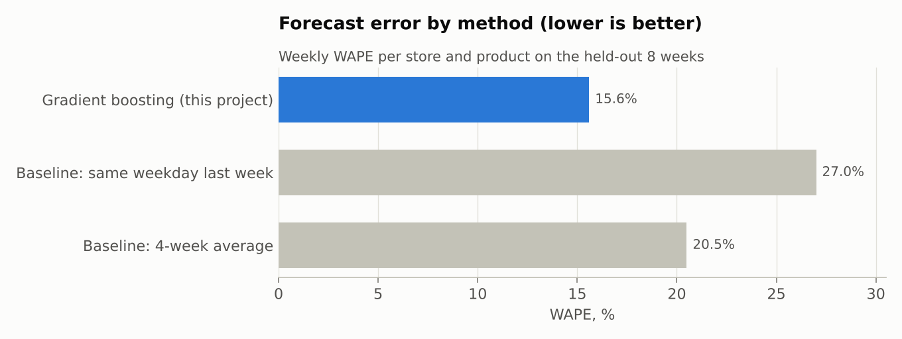
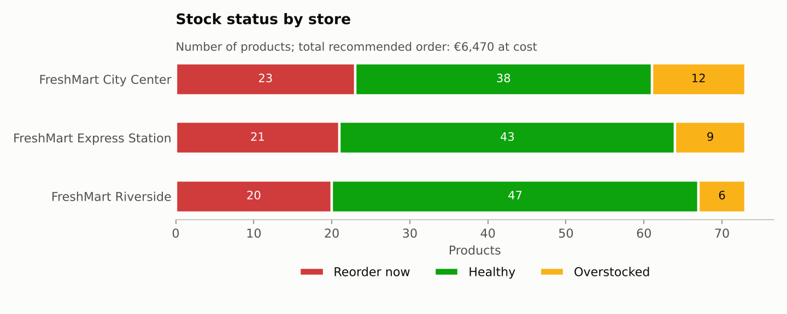
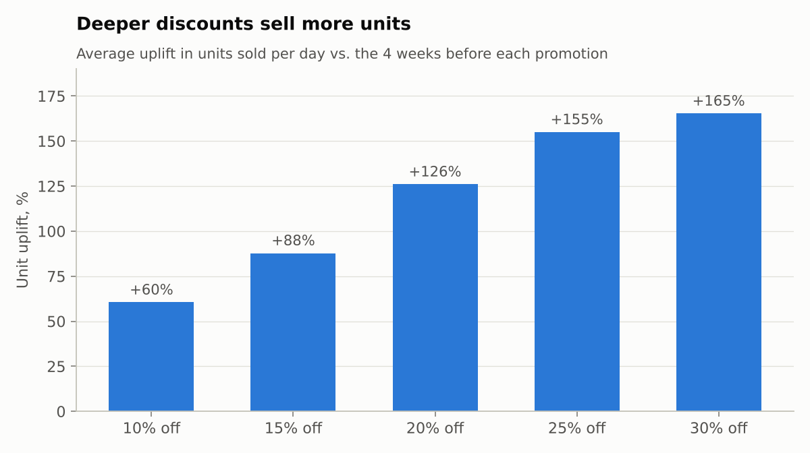
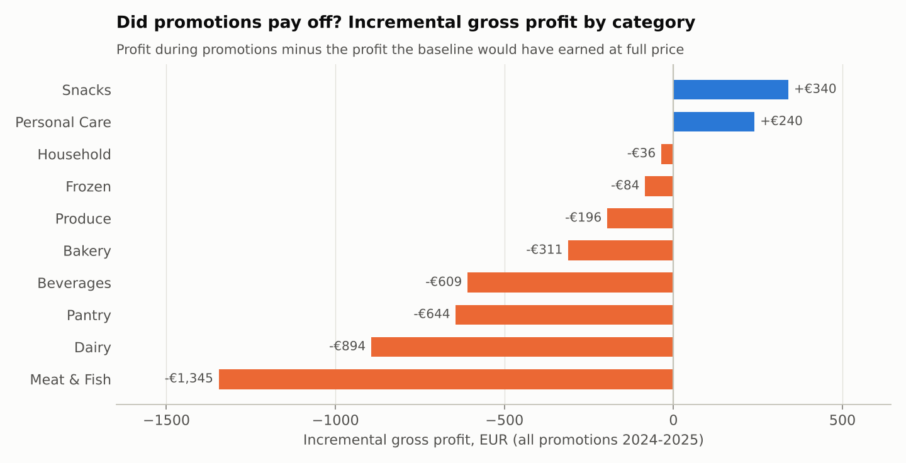

# Smart Retail Analytics

**Sales analysis, market basket analysis and demand forecasting for a supermarket chain, in one end-to-end project.**

Python · SQL · pandas · scikit-learn · Power BI

A supermarket manager does not ask for "a dashboard". They ask questions. This project answers the five that matter most for a three-store chain, from raw transactions to a recommendation someone can act on Monday morning.

| # | The manager asks | Short answer | How it is answered |
| --- | --- | --- | --- |
| 1 | Which products generate the most revenue? | Coffee Beans, Chicken Breast and Ground Beef lead; 15 of 73 products bring in 45% of revenue | SQL window functions (rank, Pareto share) |
| 2 | Which products are bought together? | Baby Wipes → Diapers (13.5x), Salsa → Tortilla Chips (8.6x), Ketchup → Burger Buns (7.4x) | Association rules (support, confidence, lift) |
| 3 | Which days and seasons sell most? | Saturday is +45% vs. an average day; December is the peak month | SQL time analysis, seasonal index |
| 4 | How much inventory should we keep? | 64 of 219 store-products need reordering now; €4.6k is tied up in excess stock | Gradient-boosting forecast → safety stock and reorder points |
| 5 | What happens during promotions? | Units rise +110% on average, but only 37% of promotions increased profit | Uplift vs. a 4-week pre-promotion baseline |

Full numbers: [`reports/insights.md`](reports/insights.md)

> **About the data.** The dataset is **simulated**. It is not real company data. A
> generator ([`generate_data.py`](retail_analytics/generate_data.py)) creates two years of
> transactions for a fictional chain, "FreshMart", with realistic behaviour built in:
> weekly and yearly seasonality, holidays, growth, price-elastic promotions and products
> that are bought together. The analyses do not know those rules; they have to rediscover
> them from the transactions, which also makes it possible to check that the methods work.

---

## Key findings

### 1. A few products carry the business



Total revenue is €2.46M at a 32.2% gross margin. Beverages is the largest category (17.4% of revenue), while Bakery has the best margin (44.2%). Revenue leaders are not margin leaders: Chicken Breast is #2 by revenue with only a 23.5% margin.

### 2. Products that belong together



Across 162,803 baskets, 50 rules pass the thresholds (support ≥ 0.5%, confidence ≥ 10%, lift ≥ 1.2). 58% of baskets with Baby Wipes also contain Diapers, 13.5 times the rate for an average basket. **Use it for:** shelf placement, bundle offers, and "promote one, keep the other at full price".

### 3. When the stores sell




Friday and Saturday together carry 38% of the week's revenue. Snacks swing the most over the year (index 80 in June, 123 in December); Frozen and Produce peak in summer. **Use it for:** staffing rosters and seasonal ordering.

### 4. Forecast-driven inventory




One gradient-boosting model forecasts daily demand per store and product, 7 days ahead. On 8 weeks it never saw during training:

| Method | Weekly WAPE | Daily WAPE | Bias |
| --- | --- | --- | --- |
| **Gradient boosting (this project)** | **15.6%** | **35.9%** | -0.7% |
| Baseline: 4-week average | 20.5% | 44.4% | -4.0% |
| Baseline: same weekday last week | 27.0% | 54.7% | +0.3% |

That is 24% less weekly error than the better baseline. Daily error per single store and product is naturally high, because a typical item sells only about 6 units a day; replenishment decisions are made on weekly totals, where the error is 15.6%.

The forecast and its error feed a periodic-review inventory policy at a 95% service level:



The output, [`inventory_plan.csv`](reports/tables/inventory_plan.csv), is an order list: per store and product, the reorder point, order-up-to level and recommended order quantity (€6,470 in total at cost).

### 5. Promotions sell more, but often earn less




| Discount | Promotions | Avg. unit uplift | Incremental profit | Profitable |
| --- | --- | --- | --- | --- |
| 10% | 40 | +61% | +€397 | 65% |
| 15% | 36 | +88% | +€108 | 50% |
| 20% | 43 | +126% | -€1,177 | 28% |
| 25% | 24 | +155% | -€1,067 | 12% |
| 30% | 18 | +165% | -€1,799 | 6% |

The 161 promotions added €38.5k of revenue but reduced gross profit by €3.5k. **Recommendation:** keep discounts at 10-15%, focus them on Snacks and Personal Care (high margin, price-sensitive), and stop deep discounts on Meat & Fish and Dairy, where margins are too thin to pay for them.

---

## How it works

```
generate_data.py ──► CSV files ──► SQLite database (sql/schema.sql)
                                        │
        ┌──────────────┬────────────────┼──────────────────┬───────────────┐
        ▼              ▼                ▼                  ▼               ▼
  sales_analysis   basket_analysis   forecasting ──► inventory        promotions
  (9 SQL queries)  (assoc. rules)    (scikit-learn)  (reorder plan)   (uplift)
        └──────────────┴────────────────┼──────────────────┴───────────────┘
                                        ▼
              reports/ (tables, figures, insights.md)  +  powerbi/data/ (star schema)
```

```
smart-retail-analytics/
├── retail_analytics/        Python package (one module per step, see diagram)
│   └── pipeline.py          runs everything in order
├── sql/
│   ├── schema.sql           tables, indexes, v_sales view
│   └── queries/             9 commented analysis queries (CTEs, window functions)
├── reports/
│   ├── insights.md          generated summary of all findings
│   ├── figures/             10 charts
│   └── tables/              every result as CSV
├── powerbi/
│   ├── README.md            data model, DAX measures, page-by-page build guide
│   └── data/                star schema: dim_date, dim_product, dim_store, fact_*
└── tests/                   unit tests for every analytical building block
```

## Run it yourself

Requires Python 3.10+.

```bash
git clone <this-repo-url>
cd smart-retail-analytics
pip install -r requirements.txt

python -m retail_analytics.pipeline     # ~30 seconds: data → database → analyses → reports
pytest                                  # 8 tests
```

The pipeline is deterministic (fixed random seed), so you get exactly the numbers shown here. Raw data and the database are regenerated locally and are not committed.

To explore the database directly:

```bash
sqlite3 data/retail.db < sql/queries/01_top_products_by_revenue.sql
```

## Power BI dashboard

`powerbi/data/` contains a star schema ready for Power BI Desktop, and [`powerbi/README.md`](powerbi/README.md) has the relationships, 28 DAX measures and a layout for four report pages (Executive overview · Products & baskets · Seasonality & promotions · Forecast & inventory). The `.pbix` file has to be built in Power BI Desktop and is not included yet.

## Method notes

**Market basket analysis.** Baskets are encoded as a sparse basket × product matrix `X`; `XᵀX` gives the co-occurrence count of every product pair in one operation. Rules are limited to pairs, which is what shelf and bundle decisions use. The same metrics are also computed in pure SQL ([`06_product_pairs.sql`](sql/queries/06_product_pairs.sql)) as a cross-check.

**Forecasting.** `HistGradientBoostingRegressor` with a Poisson objective (demand is a count). Features: weekday, time of year, holidays, price, discount, and lagged demand (7/14/21/28 days, 7- and 28-day rolling means). Every lag is at least 7 days old, so each prediction is a true 7-day-ahead forecast with no leakage; a unit test enforces this. The most important features by permutation importance are the 28-day average, weekday, product, holidays and discount ([table](reports/tables/forecast_feature_importance.csv)).

**Inventory.** `reorder point = demand × lead time + z·σ·√lead time` and `order-up-to = demand × (lead time + review period) + z·σ·√(lead time + review period)`, with `z = 1.645` (95% service level), weekly review, `demand` from the forecast and `σ` from the forecast's own hold-out errors, so hard-to-predict products automatically get more buffer.

**Promotion uplift.** Each promotion is compared with the same product's sales in the 28 days before it started (four full weeks, so the weekday mix is identical). Incremental profit accounts for the margin given away on units that would have sold anyway.

## Limitations

- The data is simulated. Real data would add stock-outs, returns, price changes, weather and competitor effects.
- The promotion baseline does not correct for seasonal drift within the comparison window, and it does not measure halo effects (extra sales of related products) or stockpiling (lower sales after the promotion).
- The inventory policy assumes fixed lead times and ignores shelf life, pack sizes and minimum order quantities.
- Forecasts beyond 7 days would need a recursive or multi-horizon setup.

## Possible next steps

- Measure promotion halo and cannibalisation using the basket rules
- Add shelf-life constraints for fresh categories
- Customer segmentation (RFM) once loyalty-card IDs are available
- Schedule the pipeline and publish the Power BI report with automatic refresh

## License

MIT, see [`LICENSE`](LICENSE).
